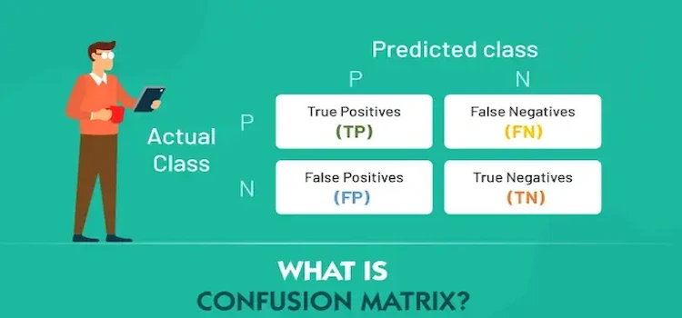
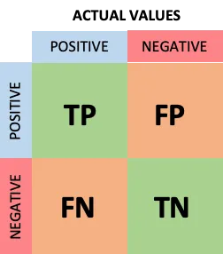

# Demystifying the Confusion Matrix

## What is Confusion Matrix

A confusion matrix is a table that is often used to describe the performance of a classification model, the result obtained from the confusion matrix is
obtained by comparing the result of the test dataset for which the true values known. depending on the type of classification model the number of classes may
vary but the concept is very simple even the correlated terminology can create confusion.

A confusion matrix is useful in the supervised learning category of machine learning using a labelled data set. As shown below, it is represented by a table.
This is a sample confusion matrix for a binary classifier (i.e. 0-Negative or 1-Positive)

## Understanding the Confusion Matrix

### True Positive (TP)

The predicted value matches the actual value The actual value was positive and the model predicted a positive value

### True Negative (TN)

The predicted value matches the actual value The actual value was negative and the model predicted a negative value

### False Positive (FP) — Type 1 error

The predicted value was falsely predicted The actual value was negative but the model predicted a positive value Also known as the Type 1 error

### False Negative (FN) — Type 2 error

The predicted value was falsely predicted The actual value was positive but the model predicted a negative value Also known as the Type 2 error

### Classification Metrics

There are multiple accuracy metrics that can be generated from the confusion matrix.

### Accuracy

Accuracy (ACC) is calculated as the number of all correct predictions divided by the total number of the dataset. The best accuracy is 1.0, whereas the worst is
0.0. It can also be calculated by 1 — ERR 

## Precision

Precision (Positive Predictive Value):

Precision is the number of True Positives divided by the number of True Positives and False Positives. Put another way, it is the number of positive predictions
divided by the total number of positive class values predicted. It is also called the Positive Predictive Value (PPV)

## Recall

Recall (Sensitivity or True Positive Rate):

Precision is the ratio of true positives to the total of the true positives and false positives. Precision looks to see how much junk positives got thrown in
the mix. If there are no bad positives (those FPs), then the model had 100% precision. The more FPs that get into the mix, the uglier that precision is going to
look. 

## F1 Score

F1 Score is the weighted average of Precision and Recall. Therefore, this score takes both false positives and false negatives into account. Intuitively it is
not as easy to understand as accuracy, but F1 is usually more useful than accuracy, especially if you have an uneven class distribution. Accuracy works best if
false positives and false negatives have similar cost. If the cost of false positives and false negatives are very different, it’s better to look at both
Precision and Recall. In our case, F1 score is 0.701

[For a Deeper Dive, Check the Original Post 🔗](https://medium.com/@akladyous/confusion-matrix-9d1ac93deb6d)

Thank you for reading! ❤️
